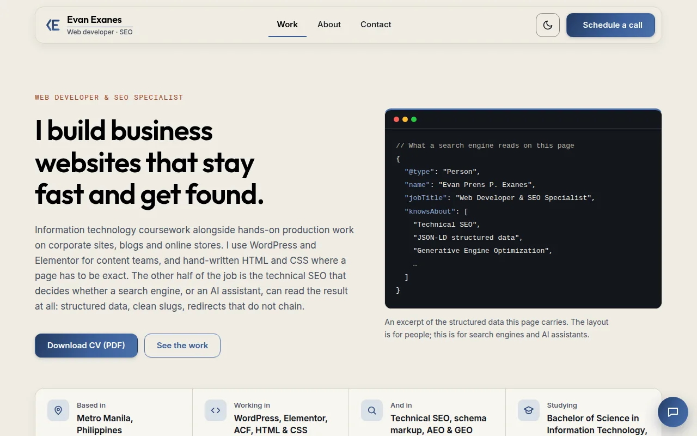

<div align="center">

# Evan Exanes: Portfolio

**Web developer and SEO specialist. Eleven pages in plain HTML, CSS and JavaScript, with no build step and no framework.**

[](https://evanexanes.github.io/)


[](LICENSE)



</div>

## Contents
- [About](#about)
- [Pages](#pages)
- [Features](#features)
- [Project structure](#project-structure)
- [Run it locally](#run-it-locally)
- [Deploy](#deploy)
- [License](#license)
- [Author](#author)

## About
The portfolio of Evan Prens P. Exanes. It shows the work behind four WordPress practice builds, two first-year programming projects and an SEO case study, plus a CV, certificates and a contact page. It was built for USERDES at Asia Pacific College.

## Pages

| Page | File |
|---|---|
| Home | `index.html` |
| Case study: corporate website | `02-case-study-corporate.html` |
| Case study: blog website | `03-case-study-blog.html` |
| Case study: e-commerce store | `04-case-study-ecommerce.html` |
| Case study: personal website | `05-case-study-personal.html` |
| About | `06-about.html` |
| Contact | `07-contact.html` |
| Case study: B2B blog articles | `08-case-study-tecadvance-blog.html` |
| Case study: MotoPulse | `09-case-study-motopulse.html` |
| Case study: NCTN Bank | `10-case-study-nctn-bank.html` |
| Case study: SEO on this site | `11-case-study-seo.html` |

The four WordPress case studies link to a live demo, a static export in its own repository: [corporate-website](https://github.com/evanexanes/corporate-website), [blog-website](https://github.com/evanexanes/blog-website), [ecommerce-website](https://github.com/evanexanes/ecommerce-website) and [personal-website](https://github.com/evanexanes/personal-website). The MotoPulse and NCTN Bank case studies link to [motopulse](https://github.com/evanexanes/motopulse) and [nctn-bank-java](https://github.com/evanexanes/nctn-bank-java).

## Features
- **Light and dark theme.** The header switch flips it, and the browser remembers the choice.
- **Phone menu.** At 1024 px and below, a hamburger opens a side drawer that traps focus, closes on Escape and hands focus back to the button.
- **Quick answers.** A panel of pre-written answers. It is not AI, and it makes no network request.
- **Consent first.** The Google Map and the Cal.com booking pop-up load only after you allow embeds. Without JavaScript the map stays a link, and Schedule a call opens Cal.com in a new tab.
- **Contact form.** It posts to Web3Forms and points to an email address if the request fails.
- **Reduced motion.** The count-up numbers and the carousel autoplay switch off when the visitor asks for reduced motion.

## Project structure

| Path | What it holds |
|---|---|
| `styles.css` | Styles for every page, including both themes |
| `script.js` | Page behaviour as independent blocks: drawer, theme switch, consent, booking pop-up, Quick answers, carousel, contact form and more |
| `assets/` | The CV (PDF), fonts, 33 certificate PDFs and images |
| `docs/` | The screenshot shown above |
| `sitemap.xml`, `robots.txt` | Files for search engines |
| `.nojekyll` | Tells GitHub Pages to serve the files as they are |

## Run it locally
There is no build step. Open `index.html` in a browser, or serve the folder:

```bash
python3 -m http.server 8000
```

Then open <http://localhost:8000>. The map, the booking pop-up and the contact form need an internet connection.

## Deploy
GitHub Pages serves the `main` branch from the repository root. A merge to `main` redeploys the site.

## License
Released under the [MIT License](LICENSE). The certificate PDFs and the portrait are personal documents and are not covered by it.

## Author
**Evan Prens P. Exanes** · [GitHub](https://github.com/evanexanes) · [Portfolio](https://evanexanes.github.io/)
